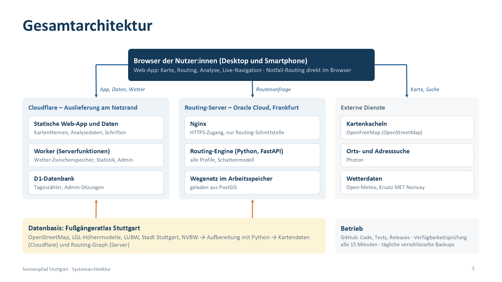
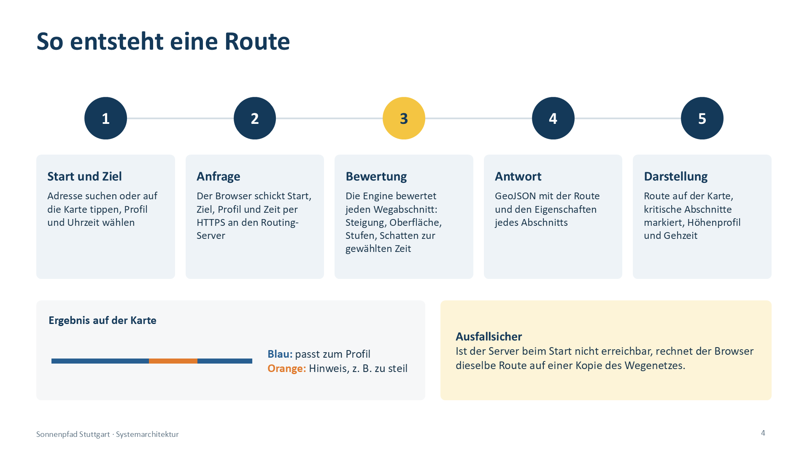
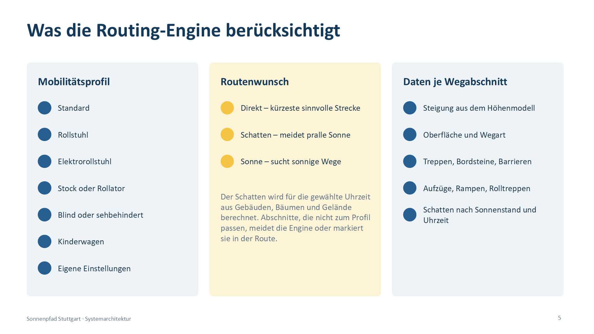
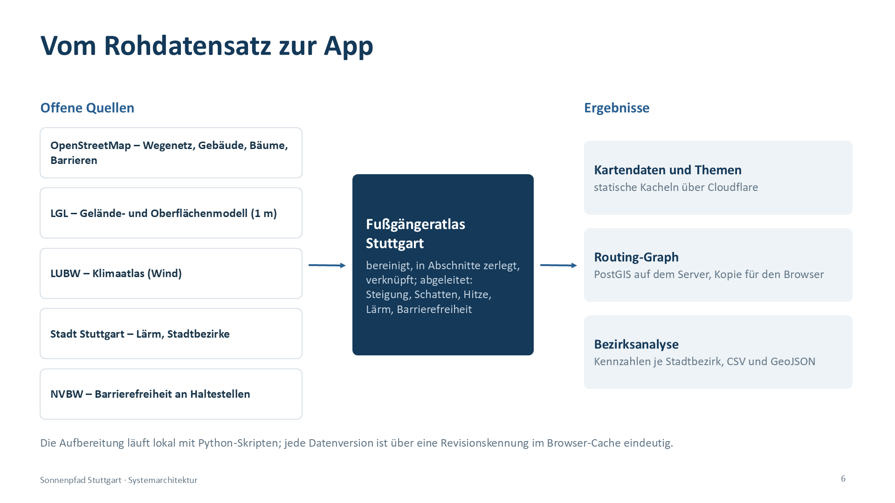
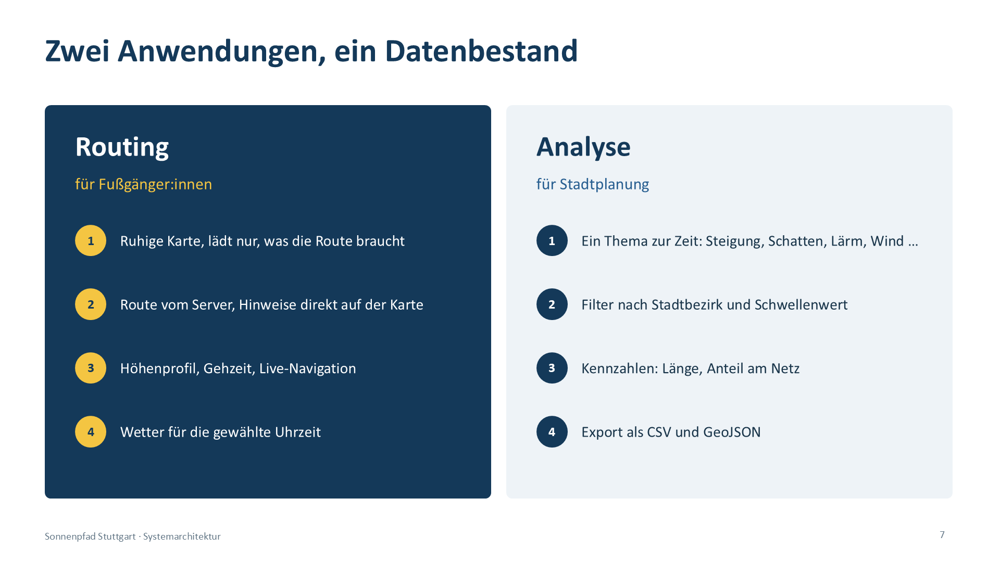
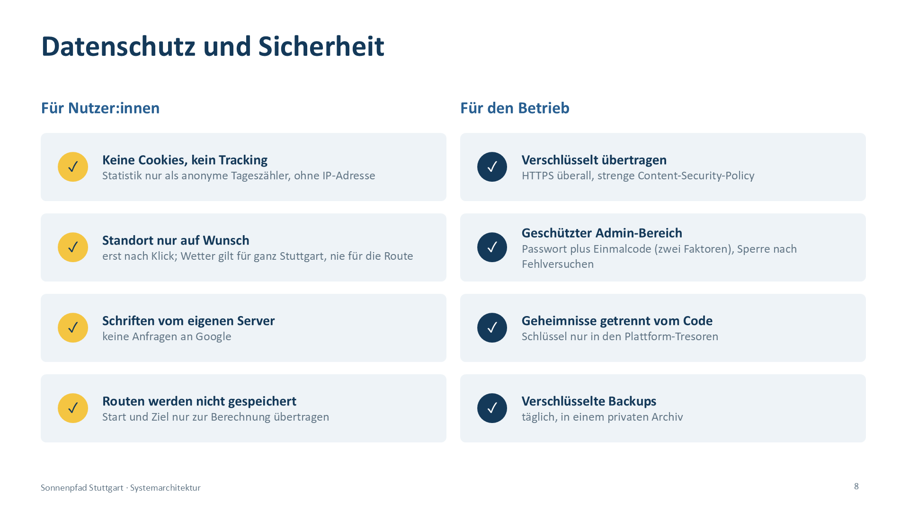
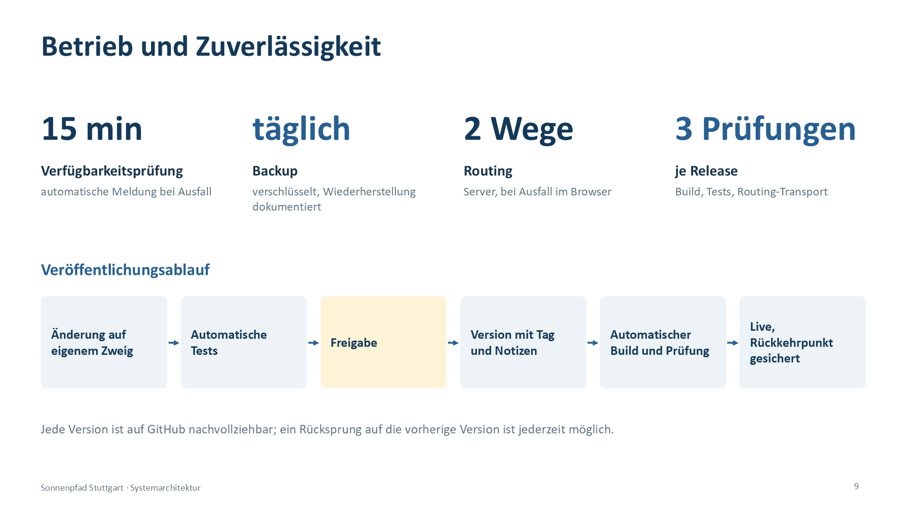
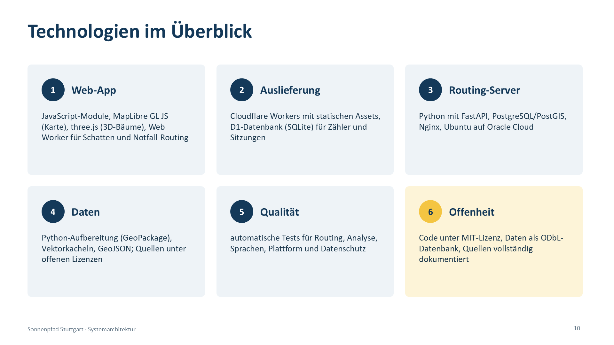

# Systemarchitektur – Präsentation

Überblick über Sonnenpfad Stuttgart für Interessierte, Partner und die Stadtplanung (Stand November 2026, Version 0.23).
Die Präsentation zum Herunterladen: [Sonnenpfad-Systemarchitektur.pptx](Sonnenpfad-Systemarchitektur.pptx). Technische Details stehen in [../architecture.md](../architecture.md).

## Gesamtarchitektur

## So entsteht eine Route

## Was die Routing-Engine berücksichtigt

## Vom Rohdatensatz zur App

## Zwei Anwendungen, ein Datenbestand

## Datenschutz und Sicherheit

## Betrieb und Zuverlässigkeit

## Technologien im Überblick

Alle Folien: [Titel](01-titel.png) · [Überblick](02-ueberblick.png) · [Abschluss](11-abschluss.png)
